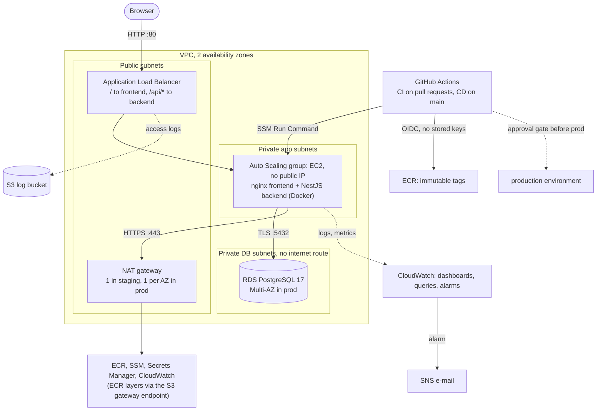

# digital-wallet-devops

A DevOps assignment: take a ready-made NestJS, React and PostgreSQL wallet app and run it on AWS with
Terraform, a GitHub Actions CI/CD pipeline and CloudWatch monitoring. Two environments (staging and
production) are built from the same Terraform modules. Pull requests are linted, tested and scanned; a merge to
`main` builds and scans the images, deploys them to staging, smoke-tests them, and waits for a human approval
before promoting the same images to production. The application runs in containers on EC2 instances behind a
load balancer, with a private PostgreSQL database, secrets in Secrets Manager, and dashboards, saved queries and
alarms in CloudWatch. Staging is applied and verified end to end; production is configured and
plan-checked but has never been applied (see [Cost](#6-cost-optimization)).

## 1. Architecture



## 2. Repo layout and prerequisites

| Path | Purpose |
|------|---------|
| `app/` | The sample application (backend, frontend, compose file); see [Credits](#7-credits) |
| `infra/bootstrap/` | Applied once, with local state: the state bucket, the GitHub OIDC provider and the two SNS topics |
| `infra/modules/` | Reusable modules: network, security-groups, iam, ecr, alb, compute, rds, secrets, monitoring, observability |
| `infra/envs/staging/`, `infra/envs/prod/` | One folder per environment, both calling the same modules; the per-environment values are in `staging.tfvars` and `prod.tfvars` |
| `.github/workflows/` | `ci.yml` (pull requests), `cd.yml` (build, staging, production), `rollback.yml` (manual) |
| `scripts/` | Deploy, smoke test, rollback and notification scripts, the load test, and a test for each (`scripts/tests/`) |
| `monitoring/` | The CloudWatch agent configuration |
| `docs/` | [APPROACH.md](docs/APPROACH.md) (how it was built and why), [REFERENCE.md](docs/REFERENCE.md) (the long build record, one section per part), [BACKUPS.md](docs/BACKUPS.md) (backup strategy, restore procedure and a measured restore drill), [CHALLENGES.md](docs/CHALLENGES.md) (problems hit and fixed) |

Versions used (taken from the machine that built this on 2026-11-12). Terraform 1.11 or later is required,
because the JWT secret uses a write-only argument.

| Tool | Version | Used for |
|------|---------|----------|
| Terraform | 1.17.1 (CI pins the same; `~> 1.11` is the floor), AWS provider `~> 6.72` | Infrastructure |
| AWS CLI | 2.39.6 | Operating and checking AWS |
| GitHub CLI (`gh`) | 2.101.0 | Variables, environments, workflow runs |
| Docker | 29.9.2 | Image builds, local compose, the k6 load test |
| Node.js | 22 in the images and CI (24.15 on the laptop), npm 10 in the images | Application tests |
| pre-commit, tflint, checkov, gitleaks | 4.7.0, 0.65.0, 3.4.3, 8.30.1 | Quality gates (`pre-commit install`) |
| trivy, hadolint | 0.76.2 (CI image 0.76.1), 2.15.1 | Dependency and image scans, Dockerfile lint |

You also need an AWS account with credentials that can create the resources (the work was done in `ap-south-1`,
Mumbai), a GitHub repository to push to, and an e-mail address for alerts.

## 3. How to set up and run

Staging first; production only when you need it. Commands are for Git Bash or PowerShell from the repository
root. In PowerShell, quote `"-var-file=staging.tfvars"`; in Git Bash set `MSYS_NO_PATHCONV=1` before AWS CLI
calls that take a `/name` argument.

1. **Make the code yours.** In a fork or copy, change what is tied to this account and repository:
   - the state bucket name in `infra/envs/staging/backend.tf` and `infra/envs/prod/backend.tf`
     (`digital-wallet-shared-tfstate-<your account id>`; a backend block cannot use variables);
   - `github_repository`, `github_owner_id` and `github_repository_id` (the defaults in `infra/bootstrap/variables.tf`
     and in each environment's `variables.tf`; get the two ids with
     `gh api repos/OWNER/REPO --jq '{owner_id: .owner.id, repository_id: .id}'`);
   - `owner` in `staging.tfvars` and `prod.tfvars`.
2. **Bootstrap the state bucket (once).** It uses local state, because Terraform needs somewhere to keep the
   state of the bucket that will hold all other state. Put your address in `infra/bootstrap/terraform.tfvars`
   (git-ignored, never commit it):
   ```
   alert_email = "you@example.com"   # pipeline failure e-mails
   alarm_email = "you@example.com"   # CloudWatch alarms
   ```
   ```
   cd infra/bootstrap
   terraform init
   terraform apply
   ```
   Then **click the confirmation link in the two e-mails AWS sends**. Until you do, nothing is delivered and
   nothing reports an error.
3. **Copy and edit the tfvars.** `staging.tfvars` and `prod.tfvars` are committed on purpose (they hold no secrets:
   the database password is created by RDS, the JWT key by Terraform) and are ready to use. For a new
   environment, copy `infra/envs/staging/terraform.tfvars.example` and edit it. Personal or secret values go in a
   `local.tfvars`, which git ignores.
4. **Plan and apply staging** (about 10 to 12 minutes, most of it the database):
   ```
   cd infra/envs/staging
   terraform init
   terraform plan  "-var-file=staging.tfvars"
   terraform apply "-var-file=staging.tfvars"
   ```
5. **Set the GitHub variables, secrets and environments.** The repository needs **no secrets**: AWS access is
   OIDC, and every value below is an ARN or a name. Create the environments in Settings, Environments:
   `staging` (deployment branches: `main` only) and `production` (required reviewer: you; deployment branches:
   `main` only).
   ```
   # repository variables, for the failure e-mails
   gh variable set NOTIFY_ROLE_ARN  --body "$(terraform -chdir=infra/bootstrap output -raw github_notify_role_arn)"
   gh variable set NOTIFY_TOPIC_ARN --body "$(terraform -chdir=infra/bootstrap output -raw pipeline_alerts_topic_arn)"

   # staging environment
   gh variable set AWS_ROLE_ARN --env staging --body "$(terraform -chdir=infra/envs/staging output -raw github_deploy_role_arn)"
   gh variable set AWS_REGION   --env staging --body ap-south-1
   gh variable set NAME_PREFIX  --env staging --body digital-wallet-staging
   gh variable set ALB_URL      --env staging --body "http://$(terraform -chdir=infra/envs/staging output -raw alb_dns_name)"

   # production environment (AWS_ROLE_ARN and ALB_URL come from `terraform output` of infra/envs/prod once it is applied)
   gh variable set AWS_REGION         --env production --body ap-south-1
   gh variable set NAME_PREFIX        --env production --body digital-wallet-prod
   gh variable set SOURCE_NAME_PREFIX --env production --body digital-wallet-staging
   ```
   Optionally protect `main` (pull request required, the nine CI jobs required, applies to admins). The full list
   of settings is in [docs/REFERENCE.md](docs/REFERENCE.md#hardening-step-28).
6. **Push to trigger the pipeline.** Open a pull request: `ci.yml` runs lint, unit and integration tests, the
   dependency, secret and image scans, the Terraform checks and the script tests. Merge it: `cd.yml` builds and
   scans both images, pushes them to ECR, deploys to staging over SSM, runs the smoke test, then waits at the
   `production` approval. The ECR repositories start empty, so the first run after every staging rebuild has to be
   re-run (Actions, latest CD run, Re-run all jobs). Cancel a run that waits for an approval you do not want (rejecting
   it sends a "CD failed" e-mail, cancelling does not).
7. **Read the URLs from the Terraform output.**
   ```
   echo "http://$(terraform -chdir=infra/envs/staging output -raw alb_dns_name)/"   # the app; /api/health is the API, /api/docs is Swagger
   terraform -chdir=infra/envs/staging output dashboard_urls    # the two CloudWatch dashboards
   terraform -chdir=infra/envs/staging output alarm_names saved_query_names
   ```
   Staging gets a new load balancer address on every rebuild, so run the `ALB_URL` command from step 5 again.
   **Type the `http://` yourself.** The load balancer has only a port 80 listener, and a browser given a bare hostname
   tries HTTPS first, so the page never loads and Chrome reports `ERR_CONNECTION_TIMED_OUT`. If Chrome keeps
   upgrading, use `curl http://<host>/api/health` to confirm the application is up.
8. **(Optional) Production**, about $200 a month, so only for a demo:
   `cd infra/envs/prod; terraform init; terraform apply "-var-file=prod.tfvars"`, then set `AWS_ROLE_ARN` and
   `ALB_URL` on the `production` environment and approve the next CD run. Staging must be up, because production
   promotes the image that passed staging instead of building its own.

**Roll back** a bad release by running the Rollback workflow (Actions, Rollback, Run workflow) with the
environment and an image tag that is still in ECR, for example
`gh workflow run rollback.yml -f environment=staging -f image_tag=3e8bbd8`. It does not undo database migrations.

### Tear everything down, in reverse

The order matters, because the environments keep their state in the bucket that bootstrap created. Three things
block a naive `terraform destroy`:

- **`deletion_protection`** (on in production). It protects the database and the load balancer, makes the database
  take a final snapshot, keeps the access log bucket and the images in the ECR repositories, and gives the secrets
  a 30 day recovery window. Set it to `false` in `prod.tfvars`, **apply**, and only then destroy; destroy acts on
  the stored state, so the change has to be applied first. Staging has it off and destroys cleanly.
- **Left-over snapshots.** Production's final snapshot (`digital-wallet-prod-final`) and the pre-deploy snapshots
  survive the destroy and are billed until you delete them (`aws rds delete-db-snapshot`).
- **The versioned state bucket.** It has `prevent_destroy` and keeps every version of every state file, so it
  cannot be deleted while it holds anything. Remove the `prevent_destroy` line in `infra/bootstrap/main.tf`, empty
  the bucket including all versions and delete markers (the console's "Empty" button does it, or
  `aws s3api list-object-versions` piped into `aws s3api delete-objects`), then destroy bootstrap.

```
cd infra/envs/prod    && terraform destroy "-var-file=prod.tfvars"      # only if it was applied, after deletion_protection = false
cd infra/envs/staging && terraform destroy "-var-file=staging.tfvars"
cd infra/bootstrap    && terraform destroy                              # last, after the bucket is emptied
```

Staging is destroyed and rebuilt this way every day. The production and bootstrap teardown has not been run; its
steps follow from the code. Afterwards delete the GitHub variables and environments. Production's two secrets stay
in their 30 day recovery window unless you force-delete them.

## 4. Architecture decisions

Each row is a decision with real alternatives; the context, consequences and what would change the answer are in
[docs/APPROACH.md](docs/APPROACH.md#architecture-decision-records).

| Decision | Alternatives considered | Why |
|----------|------------------------|-----|
| EC2 Auto Scaling group running Docker | ECS on Fargate, EKS | Two small containers do not need an orchestrator. EC2 is the cheapest, shows the most of the stack (AMI, user data, instance profile) and keeps the deploy path simple. Cost: we patch and run Docker ourselves |
| CloudWatch for metrics, logs and alarms | Grafana, Prometheus | Nothing to run or patch, native to every AWS service used, and alarms, dashboards and Logs Insights come in one place. Cost: weaker dashboards and no application tracing |
| One folder per environment | Terraform workspaces | Each environment has its own state key and reviewable tfvars, and nobody can apply to the wrong workspace. Cost: four duplicated files, kept identical by a `diff` |
| SSM Run Command for deploys | CodeDeploy, SSH | No SSH and no extra service: the pipeline sends one command to instances found by tag, one at a time, and waits for the smoke test. Cost: no built-in traffic shifting |
| RDS-managed secret in Secrets Manager (and a Terraform-made JWT secret) | SSM Parameter Store SecureString, a password variable | The password never enters code or state, and RDS rotates it. Cost: $0.40 per secret per month; Parameter Store is cheaper but has no rotation |
| HTTP only on the load balancer | HTTPS with ACM and Route 53 | There is no domain, so there is no certificate to issue. Disclosed, and the first item to fix with a domain |
| OIDC roles scoped to repo, branch and environment | IAM user with access keys | No long-lived key to leak, and the production role is only usable after the approval |
| Promote the staging image to production | Rebuild the commit for production | Production runs exactly what was scanned and smoke-tested, checked by digest. Cost: needs staging up |
| One NAT gateway in staging, one per AZ in production | One everywhere | Saves about $45 a month in staging at the price of a single point of failure there |
| S3 gateway endpoint, no interface endpoints | Interface endpoints for ECR and SSM | The gateway is free and carries the image layers; five interface endpoints would cost about $95 a month |
| Alarm topic and e-mail subscription in `bootstrap` | One topic per environment | Staging is rebuilt daily and a recreated e-mail subscription needs a click to confirm |

## 5. Security considerations

| Control | How it is done |
|---------|---------------|
| Network isolation | Only the load balancer is public. The app tier accepts traffic from the load balancer's security group only, the database from the app tier's only; neither has a public IP, and the database subnets have no route to the internet |
| Least-privilege IAM | The instance role reads this environment's two ECR repositories and exactly two secrets and one parameter, by ARN. The deploy roles are assumed by OIDC only for this repository, in the immutable subject form, and for one GitHub environment; the notify role can only publish to one topic |
| No SSH | No key pair and no port 22 rule; access is SSM Session Manager and Run Command |
| Encryption at rest | EBS volumes, RDS storage, ECR (AES256), the state and access log buckets (SSE-S3), Secrets Manager |
| Encryption in transit | The database requires TLS (`rds.force_ssl` and `sslmode=require` in the connection URL); egress from the instances is 443 only; the state bucket refuses non-TLS requests. **The load balancer is HTTP only**, see the gaps below |
| Hardened instances | IMDSv2 required with a hop limit of 1, so containers cannot reach the instance role's credentials; the backend runs as a non-root user; base images are pinned to exact versions |
| Secrets handling | The database password is created and rotated (every 7 days) by RDS and the JWT key by Terraform through a write-only argument, so neither is in the code, the state or an output (the outputs are ARNs). Instances read them at deploy time with their role. The repository has no GitHub secrets at all. gitleaks runs in pre-commit and in CI |
| Supply chain | Trivy on the dependencies and on the built images (fixable HIGH and CRITICAL findings fail the job), weekly grouped Dependabot, ECR scan on push, immutable image tags, every GitHub Action pinned to a full commit SHA (enforced by a repository setting and by `scripts/check-workflows.sh`), read-only workflow permissions by default |
| Change control | `main` accepts only pull requests with the nine CI jobs green, including for admins; production deploys wait for a reviewer on an environment that only `main` can enter |
| Audit trail | Load balancer access logs in S3 and application, system and database logs in CloudWatch, with retention set per environment (14 days in staging, 90 in production); alarms e-mail on errors and failures |
| **Honest gaps** | HTTP only without a domain; no WAF; one AWS account for both environments; no CloudTrail trail, GuardDuty, Config or VPC flow logs managed here (CloudTrail's 90 day event history exists, but nothing is retained or alerted on); the frontend container runs nginx as root; Swagger UI is reachable at `/api/docs` through the load balancer; the alarm topic is not encrypted (CloudWatch cannot use the AWS-managed key); the repository is public; a running backend keeps the database password it started with, so after RDS rotates it the backend needs a restart or a deploy (undecided: turn rotation off, or re-read the secret on failure) |

Findings the scanners report and that were accepted on purpose are listed, with the reason for each, under
[Quality gates](docs/REFERENCE.md#quality-gates) in the reference.

### Backups and recovery

The database is the only state worth backing up. RDS takes automated backups (1 day of point-in-time restore in
staging, 7 days in production, in a 02:30 to 03:00 IST window), the pipeline takes a named snapshot before every
production deploy, and the Terraform state bucket is versioned. The instances are stateless and rebuilt by the Auto
Scaling group from ECR, so they are not backed up. A restore drill on staging brought the database back in about
13 to 15 minutes, with the latest restorable point 3 to 8 minutes behind the clock. The procedure, the measurements
and what was not tested (production has never been applied) are in [docs/BACKUPS.md](docs/BACKUPS.md).

## 6. Cost optimization

**Estimate** (on-demand, Mumbai, USD, 730 hours a month, from the AWS Price List API on 2026-11-12; not the Pricing
Calculator, and traffic is low, so the small items are rounded up):

| Item | Staging | Production |
|------|--------:|-----------:|
| NAT gateway ($0.056/h) and its public IPv4 address ($0.005/h) | $44.5 (1) | $89.1 (2) |
| Application Load Balancer ($0.0239/h) and its two public IPv4 addresses | $24.7 | $24.7 |
| EC2 `t3.small` ($0.0224/h) | $16.4 (1) | $32.7 (2) |
| EBS gp3, 20 GiB each ($0.0912/GB-month) | $1.8 | $3.6 |
| RDS `db.t4g.micro` ($0.021/h, Multi-AZ $0.042/h) | $15.3 | $30.7 |
| RDS gp3 storage, 20 GiB ($0.131/GB-month, Multi-AZ $0.262) | $2.6 | $5.2 |
| Secrets Manager, 2 secrets ($0.40 each) | $0.8 | $0.8 |
| CloudWatch: 10 alarms ($0.10), custom metrics ($0.30), logs ingested ($0.67/GB), dashboards (first three free) | $4 | $6 |
| Load balancer capacity units, NAT data processing, S3, ECR | $3 | $4 |
| **Total, running all month** | **about $115** | **about $200** |

The first four rows are almost all of it, and they are billed by the hour. A staging environment that is destroyed
outside working hours costs about **$0.14 per hour it exists**, so four hours a day is about $17 a month. Production
is configured for resilience and only applied for a demo; to run it at staging size set `single_nat_gateway = true`,
`db_multi_az = false` and the Auto Scaling minimum and desired size to 1 in `prod.tfvars`.

What keeps the bill down, and what each lever costs:

| Lever | Effect and trade-off |
|-------|---------------------|
| Destroy staging when not in use | The biggest saving; costs a 10 to 12 minute rebuild and a new load balancer address |
| One NAT gateway in staging | Saves a gateway (about $45 a month) per extra AZ; a single point of failure, accepted for staging |
| Small burstable instances (`t3.small`, `db.t4g.micro`) | Lower hourly cost; limited sustained CPU. Measured on staging: 40 requests a second used at most 18.5% CPU |
| gp3 everywhere, 20 GiB volumes | Cheaper per GB than older types; sizes checked against real usage |
| Short log retention (14 days staging), S3 lifecycle on access logs, ECR keeps the last 10 images | Stops silent storage growth |
| S3 gateway endpoint | Image layers bypass the NAT gateway; free |
| CloudWatch instead of a hosted Grafana | No extra servers or licences |
| Cost allocation tags | Every resource carries `project`, `environment`, `managed-by` and `owner`. Activating them in the Billing console, and an AWS Budget, are not set up |
| Savings Plans or reserved capacity | A later step for production once usage is stable |

## 7. Credits

The application in `app/` is [tedrosdev/digital-wallet](https://github.com/tedrosdev/digital-wallet), imported at
upstream commit `011bd00b2e43aee3c9f955b4bd84b73ac40338b7` (2024-12-23). The first commit in this repository
(`79f2d44`) is that import with the file contents unchanged, so every later commit shows what was changed on top
of it. The original README is kept at `app/UPSTREAM_README.md`.

**Licence note.** The upstream README says the project is MIT-licensed and links to a `LICENSE` file, but no
`LICENSE` file was visible in the upstream repository root, and its `backend/package.json` declares
`"license": "UNLICENSED"`. No licence text has therefore been copied here, and the application is used on that basis
for this assignment only.

**What was changed from upstream** (`git diff 79f2d44 HEAD -- app`):

- **Dockerfiles:** a multi-stage backend image that runs as a non-root user and has OpenSSL in every stage (Prisma
  needs it), a frontend image built with Vite and served by nginx, `.dockerignore` files, and dependency upgrades
  (for example `bcrypt` 6) so the image scans are clean.
- **nginx config:** `frontend/nginx.conf` serves the single-page app and is what the load balancer's default
  route reaches.
- **Health route:** a public `GET /api/health` for the load balancer and the smoke test.
- **Integration test:** a database-backed test (`wallet.integration-spec.ts`) with its own config and script, in
  place of the upstream `app.e2e-spec.ts`.
- **Secrets handling:** upstream's compose file had the database password and the JWT signing key written in it,
  and its auth guard logged every request's headers and the extracted token. Compose now reads both values from a
  git-ignored `app/.env` and refuses to start without them, the guard no longer logs tokens, and in AWS the
  database password (RDS-managed) and the JWT key (Terraform-generated) live in Secrets Manager and are read by
  `scripts/deploy.sh` at deploy time.
- **Logging:** one JSON line per event with a request logger and a trace id, in place of `console.log`, so
  CloudWatch can query it.
- **Small fixes:** a relative import in `auth.module.ts` and a `tsconfig.build.json` `include`, so the production
  build works.
